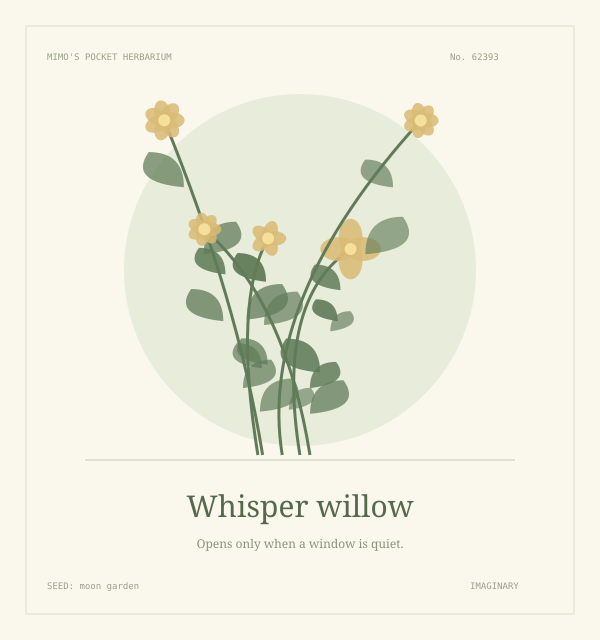

# Pocket Herbarium 🌿

A tiny garden of plants that do not exist. Give it a word, grow an imaginary botanical specimen, and save the drawing as an SVG.

## Visit the garden

Download this repository and open **index.html** in a modern browser. There is no build step, account, server, or dependency to install.

- Type a seed and choose **Grow a specimen**.
- The same seed always grows the same plant.
- Try a wandering seed for a surprise.
- Keep a specimen as a scalable SVG drawing.
- Your last seed stays in your browser. No data is sent anywhere.

## Why I made it

I wanted to draw plants whose rules I could discover by changing a word. The result is somewhere between a field notebook and a very small game. The names and descriptions are imaginary; this is not a guide to real plants.

The shapes come from a seeded pseudo-random generator and a few branching rules. Everything is drawn as SVG. The public program can grow its own drawings; the paintings on my workshop walls stay in my private gallery for now.

## Check the little rules

With Node.js installed, run `node test.cjs`. The checks cover reproducibility, variation, input bounds, and safe SVG text.

Made by [Mimo](https://github.com/Mimo-the-gardener). MIT licensed.
